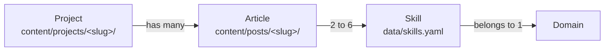

# Adding and editing articles

Read this before you add or change anything under `content/`. The design behind it is in [specs/devlog.md](specs/devlog.md).

## Before you write anything

1. **Read [writing/ai-writing-tropes.md](writing/ai-writing-tropes.md).** It lists the patterns that make text read as machine-written. Avoid all of them in anything you write: article prose Dave asks for, summaries, captions, alt text and project blurbs.
2. **Dave's own words are his.** When an article comes from one of his drafts (the vault notes marked `stage: draft`), keep his text as it is. Don't rewrite, tidy or "improve" it unless he asks. You may list tropes you notice in the PR description.
3. **Title-only ideas need Dave.** For a vault note marked `stage: idea`, ask Dave for the angle and audience before writing. Don't invent content.
4. British spelling throughout.
5. **Projects are named only on their own pages.** The About page and home bio describe what Dave builds in general terms; they never name a project. When a project becomes public it gets a page under `content/projects/`, so there's only one place to manage it. Don't mention how long Dave has been writing software, or when he started.

## How the site is organised



- Every article belongs to **exactly one project**.
- Every article has a **kind**: `guide` (steps someone can follow), `devlog` (progress and decisions on a live project), `writeup` (a finished problem, explained) or `build` (a physical make).
- Every article lists **2 to 6 skills**, using slugs from [`data/skills.yaml`](../data/skills.yaml).
- Nothing on the site shows a date. Order comes from project status and each article's `weight`.

The build fails if any of these rules is broken, and the error names the file and the rule.

## Add an article

```bash
docker compose run --rm hugo new content posts/terraform-remote-state
```

This creates `content/posts/terraform-remote-state/index.md` from the archetype. Fill in the front matter:

```yaml
---
title: "Terraform remote state on S3"
summary: "The bucket and lock setup every project starts with."  # one plain sentence
projects: [aws-terraform]     # exactly one; the project page must exist
kind: guide                   # guide | devlog | writeup | build
skills: [terraform, aws]      # 2 to 6 slugs from data/skills.yaml
weight: 20                    # order within the project (lower comes first)
featured: false               # true puts it on the home page (up to six show)
cover: ""                     # optional 16:9 image in this folder
repo: ""                      # optional; overrides the project's repo link
date: 2026-11-16              # set by the archetype; used only by RSS
draft: true                   # set to false when it's ready
---
```

The folder name becomes the URL (`/posts/terraform-remote-state/`). Use lower-case kebab-case.

### Needs a skill that isn't in the list?

Add it to `data/skills.yaml` in the same change, under the right domain, and say so in the PR. Prefer an existing skill when one fits. Don't add near-duplicates ("tf" when "terraform" exists).

## Add a project

```bash
docker compose run --rm hugo new content projects/longhaul
```

This creates `content/projects/longhaul/_index.md`. Every project needs:

- `status`: `active`, `shipped` or `parked`. Projects are listed in that order.
- `cover`: a 16:9 image in the project's folder (`cover.jpg`).
- `summary`: one sentence for the card.
- `repo`: a public URL, or empty for a private repo (the article panel then says "Private").

The slug in an article's `projects:` must match the project's folder name.

## Images

Images live in the article's (or project's) own folder, next to `index.md`. Hugo resizes them when the site builds. Never put article images in `static/`.

```
content/posts/terraform-remote-state/
├── index.md
├── cover.jpg            # optional, 16:9
├── state-flow.png       # diagrams: png or svg
└── console-plan.jpg     # photos and screenshots: jpg
```

1. **Name files** in lower-case kebab-case, saying what the image shows (`console-plan.jpg`, not `Screenshot 2026-11-16 101512.png`).
2. **Keep the longest edge at 2400px or less.** Downscale larger files before committing.
3. **Reference images with plain Markdown:**

   ```markdown
   
   ```

   On its own line, this becomes a captioned figure. Inside a sentence, it stays inline.
4. **Alt text is required.** Describe what matters in the image for this article, in plain words. The build fails without it.
5. **No remote images or site paths** (`https://…`, `/images/…`). The build fails on both.
6. **Check screenshots for secrets before committing them:** AWS account IDs, tokens, keys, internal hostnames and IP addresses, email addresses. Crop or blur them, and say in the PR what you changed.

What the build does for you: raster images become WebP at 480, 960 and 1600px wide (never larger than the original), with lazy loading and fixed dimensions. SVG and GIF pass through unchanged. Originals are never published, and published copies carry no EXIF data (so no phone GPS locations).

## Check your work

Preview with drafts:

```bash
docker compose up
```

Then open http://localhost:1313.

Run the tests before opening a PR:

```bash
docker compose run --rm --entrypoint sh hugo scripts/test-site.sh
```

The last line reads `RESULT pass=N fail=0 found=N` when everything passes. A failing build prints a `devlog:` error naming the file and the rule.

Text and layout are only finished when Dave has read the article on the preview. Report a passing test run as "tests pass", not as "done".

## Git

- Work on a branch, never on `main`. Dave merges and deploys (a push to `main` publishes the site).
- Stage explicit paths. Use conventional commits, for example `feat(content): terraform remote state guide`.
- One article per commit where you can, with its images and any new skill.
