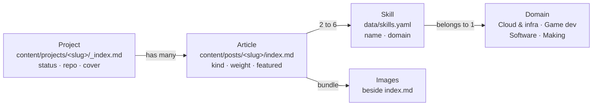

# Spec: dev log (projects, skills, images)

**Status:** approved by Dave on 2026-11-16. WP0 to WP8 built: HEADLESS-GREEN (`scripts/test-site.sh`, 33 checks), and awaiting Dave's visual check.
**Branch:** `feature/devlog`
**Design:** option B (project shelves) plus option C's filterable skills page, chosen by Dave on 2026-11-16. Mock-ups: https://claude.ai/artifact/K5cRoqU3XKKgZMNDWnK7uQ

## North star

dblencowe.wtf is a public notebook of the things Dave builds. It does three jobs:

1. It reminds Dave how he did something.
2. It shows a potential employer how wide his skills go, in one or two screens.
3. It builds a personal brand without needing a posting schedule.

So nothing is dated on the page, nothing looks stale when posting goes quiet, and adding an article is a matter of dropping a folder into `content/posts/`.

## Decisions

| # | Decision | Chosen | Reason |
|---|---|---|---|
| D1 | Layout | Option B: project cards, plus a spec-sheet panel on each article | Shows range at a glance; project status replaces dates as the freshness signal |
| D2 | Skills page | Option C's filterable index at `/skills/` | Answers "has he done X?" for someone scanning |
| D3 | Dates | Never rendered. `date` stays in front matter for RSS, the sitemap and `article:published_time` | Posting is irregular; feeds and search engines still need a date |
| D4 | Ordering | Projects by status (active, then shipped, then parked), then title. Articles by `weight` within a project | Stable order with no dates |
| D5 | Taxonomies | `projects` (exactly 1 per article) and `skills` (2 to 6, from a fixed list) | Two real taxonomies give term pages and counts for free |
| D6 | Kind | A front-matter param, `kind`: `guide`, `devlog`, `writeup` or `build` | Four fixed values don't need term pages |
| D7 | Skills vocabulary | `data/skills.yaml`; every skill has a display name and a domain | Stops drift ("tf", "terraform"); domains drive the grouped skills page |
| D8 | Images | Page bundles, a Markdown render hook, WebP at build time, originals never published | One process an agent can follow; no EXIF or GPS leaks |
| D9 | Validation | The Hugo build fails on broken rules (taxonomy counts, unknown skill, missing alt text, missing image) | Mistakes are caught before deploy, not by a reader |
| D10 | Theme | The vendored theme stays untouched; every change goes in the site's own `layouts/`, `assets/` and `archetypes/` | Theme updates stay a straight copy |
| D11 | Palette | Keep the current yellow light theme and the existing dark theme | A redesign can come later as its own step |
| D12 | Writing guard | `docs/writing/ai-writing-tropes.md` (from tropes.fyi) is required reading for any agent writing or reviewing article text. It's kept outside `content/`, so it's never published | Dave asked for it so agents don't write bad content |
| D13 | 3D print gallery | The Workshop project page, with its Build articles, is the gallery | Avoids a second content type |

## Content model



### Article front matter

```yaml
---
title: "Terraform remote state on S3"
summary: "The bucket and lock setup every project starts with."
projects: [aws-terraform]     # exactly one
kind: guide                   # guide | devlog | writeup | build
skills: [terraform, aws, s3]  # 2 to 6 slugs from data/skills.yaml
weight: 20                    # order within the project; also series order
featured: false               # true puts it on the home page
cover: cover.jpg              # optional, a file in the bundle
repo: ""                      # optional; overrides the project's repo
date: 2026-11-16              # set by the archetype; never shown
draft: true
---
```

### Project front matter (`content/projects/<slug>/_index.md`)

```yaml
---
title: "Longhaul"
summary: "Realistic multiplayer flight sim in Unreal Engine 5.8."
status: active                # active | shipped | parked
repo: ""                      # a public URL, or empty for private
cover: cover.jpg              # required, 16:9
weight: 10                    # tie-breaker inside a status group
---
Optional longer description, shown at the top of the project page.
```

The project page is the taxonomy term page for `projects`, so its bundle can hold the cover image.

### Skills vocabulary (`data/skills.yaml`)

```yaml
domains:
  infra:  "Cloud & infra"
  game:   "Game dev"
  soft:   "Software"
  make:   "Making"
skills:
  terraform: { name: "Terraform", domain: infra }
  unreal-cpp: { name: "Unreal C++", domain: game }
  # ...
```

The starting list is the one from the mock-up:

- **Cloud & infra:** aws, terraform, dns, ansible, kubernetes, linux, networking, github-actions
- **Game dev:** unreal-cpp, blueprints, multiplayer, procedural, vr, steamworks
- **Software:** go, python, typescript, hugo, testing, scraping
- **Making:** 3d-printing, openscad, electronics, embedded, home-assistant, woodwork

Agents add a skill to the file in the same change as the article that first needs it, and say so in the PR.

## Pages

| URL | What it shows |
|---|---|
| `/` | The existing bio, then up to six featured articles, then cards for active projects |
| `/projects/` | Project cards (cover, title, summary, status pill, top skills), ordered as in D4, then a link to all articles |
| `/projects/<slug>/` | Cover, description, status, repo, then the project's articles in `weight` order |
| `/posts/` | Every article, grouped under its project. The year headings are gone |
| `/posts/<slug>/` | The article, with the spec-sheet panel (below) |
| `/skills/` | Skills grouped by domain, each with an article count. Under that, a filterable index of every article. Filter chips for domain and skill combine with AND. The page works without JavaScript: the filter only hides rows |
| `/skills/<slug>/` | Every article showing that skill, grouped by project |

Menu: Home, Projects, Skills, About.

### Article spec sheet

A side panel on wide screens, and a compact block under the title on phones:

- **Project:** linked
- **Status:** the project's status pill
- **Kind**
- **Stack:** skill chips, each linking to `/skills/<slug>/`
- **Source:** the article's `repo`, else the project's, else "Private"
- **In this project:** "3 of 7", with previous and next links by `weight`

### Where dates are removed

Visible dates come from the theme's `_default/single.html` and `partials/postCard.html`. Both get site-level overrides in `layouts/`. The theme's `meta/post.html` keeps `article:published_time`, which isn't visible.

## Images

### Layout

```
content/posts/terraform-remote-state/
├── index.md
├── cover.jpg            # optional, 16:9
├── state-flow.png       # diagrams: png or svg
└── console-plan.jpg     # photos and screenshots: jpg
```

### Rules

1. **Originals go in the bundle.** File names are lower-case kebab-case and say what the image shows. The longest edge is 2400px or less; anything larger is downscaled before it's committed.
2. **Reference images with plain Markdown:** ``.
3. **The render hook** (`layouts/_default/_markup/render-image.html`):
   - finds the image as a page resource, and fails the build if it isn't there;
   - fails the build if the alt text is empty;
   - fails the build on remote URLs, so every image lives in a bundle;
   - outputs a `<figure>`, with a `<figcaption>` when there's a title;
   - converts raster images to WebP at 480, 960 and 1600px wide (never wider than the original), with `srcset`, `sizes`, `width`, `height`, `loading="lazy"` and `decoding="async"`;
   - passes SVG and GIF through unchanged.
4. **Covers** are cropped to 16:9 in WebP for cards (640px) and article headers (1600px).
5. **Only processed copies are published.** A `[[cascade]]` in `hugo.toml` sets `build.publishResources: false` for `/posts/**` and `/projects/**`, so originals never reach S3. (Section front matter didn't reach the project term pages, so the cascade lives in config.)
6. **Screenshots are checked before they're committed** for account IDs, tokens, internal hostnames and IP addresses. The agent crops or blurs them, and says what it changed in the PR.

## Writing guard

`docs/writing/ai-writing-tropes.md` is a verbatim copy of the tropes.fyi list (source: https://tropes.fyi/tropes-md, by ossama.is). It lists 49 patterns that mark text as machine-written.

- Any agent writing article text (prose Dave asks for, summaries, captions, alt text, project blurbs) reads it first, and avoids those patterns.
- Text from Dave's own drafts is never rewritten without being asked (the rule from the vault's publishing notes). An agent may list the tropes it finds in a draft, as a note in the PR.
- The file is outside `content/`, `static/` and `assets/`, so Hugo never publishes it. A test checks this (T7).

## Agent guide

`docs/articles.md` is the one file a future agent reads before adding or changing an article. It covers the front matter, the skills list, the image rules, the writing guard and the commands. `AGENTS.md` at the repo root points to it, along with the git and verification rules.

Archetypes create the bundles:

```bash
docker compose run --rm hugo new content posts/terraform-remote-state
```

```bash
docker compose run --rm hugo new content projects/longhaul
```

These use `archetypes/posts/index.md` and `archetypes/projects/_index.md`.

## Work packages

| WP | What | Done when |
|---|---|---|
| WP0 | `.gitattributes` pinning LF (working practice rule 8); renormalise | `git ls-files --eol` shows `i/lf` for text files |
| WP1 | Taxonomies, `data/skills.yaml`, cascades, menu, archetypes | Build passes with the fixture content |
| WP2 | Validation partial (D9) | T2 fixtures fail with the expected messages |
| WP3 | Image render hook and cover partial | T3, T4 and T5 pass |
| WP4 | Article layout and spec sheet; date removal | T6 passes |
| WP5 | `/projects/`, project term pages, `/posts/` grouping, home page | Pages render in the right order (T8) |
| WP6 | `/skills/` page with the filter, and skill term pages | T9 passes |
| WP7 | SCSS for cards, chips, status pills and the spec sheet, in light and dark | Visual check by Dave |
| WP8 | `docs/articles.md`, `AGENTS.md`, README update; remove the sample `first-post.md` | Docs match the code |

Each WP is committed when its tests go green.

## Verification

`scripts/test-site.sh` runs inside the Hugo container (`docker compose run --rm --entrypoint sh hugo scripts/test-site.sh`). It builds the real site, then builds fixture content from `tests/fixtures/` with `--contentDir`, using the same layouts.

| Test | Checks |
|---|---|
| T1 | The real site builds with `--gc --minify` and no warnings |
| T2 | Each bad fixture fails with its own message: no project, two projects, one skill, seven skills, unknown skill, unknown kind, missing image, empty alt, remote image, project without a status |
| T3 | No original `.jpg` or `.png` from a bundle appears in `public/` |
| T4 | A fixture image produces WebP files at the expected widths, and the `` has `srcset`, `width`, `height` and `loading="lazy"` |
| T5 | A fixture JPEG carrying EXIF GPS data produces WebP output with no EXIF chunk |
| T6 | No article or list page contains a `<time>` element or the article's date |
| T7 | `public/` contains nothing from `docs/` (no `ai-writing-tropes`) |
| T8 | `/projects/` lists fixture projects in status order; a project page lists its articles by `weight` |
| T9 | `/skills/` shows each domain with the right counts; every skill term page exists |

Passing tests make it HEADLESS-GREEN. The layout and look (WP4 to WP7) are DONE only when Dave has checked them on `docker compose up`, in light and dark and at phone width.

## Implementation notes

Changes from the plan above, found while building:

- **RSS template.** The theme's `rss.xml` reads `.Site.Author`, which Hugo removed in 0.156, so the site didn't build on the pinned Hugo 0.166, `main` included. `layouts/rss.xml` replaces it.
- **Open Graph images.** The theme's head calls Hugo's built-in Open Graph template, which published any `cover.*` file at full size, EXIF and all. `layouts/_partials/_funcs/get-page-images.html` replaces the built-in image picker with a processed 1200×630 crop of `cover`.
- **Fixed lists.** Kinds and statuses live in `data/kinds.yaml` and `data/statuses.yaml` next to `data/skills.yaml`, so templates and validation read one source.
- **Validation** runs from the home page template (`layouts/_partials/devlog/validate.html`), so every rule runs on every build.
- **Fixtures** are built as `tests/fixtures/base` plus an overlay: `good/` for the passing site, and `bad/<case>/content` with an `expect.txt` for each failing case.
- **Theme deprecations.** The vendored theme still uses fields Hugo has deprecated (`.Site.LanguageCode`, `.Language.LanguageName`). These are warnings for now; T1 ignores deprecation warnings and fails on any other kind.

## Out of scope

- Moving the drafts from the vault into articles (next step, once this is approved).
- Any change to infra, the deploy workflow or the palette.
- Search, comments and analytics.

## Open questions (2)

1. **Licence for the tropes file.** tropes.fyi doesn't state one. The repo has no remote yet; if it's ever pushed somewhere public, a verbatim copy would be redistributed. Applied default: committed with its attribution intact.
2. **First projects.** Applied default: project pages are only created for projects that have an article. None exist yet, so the live site has no articles until the drafts move over (next step).
